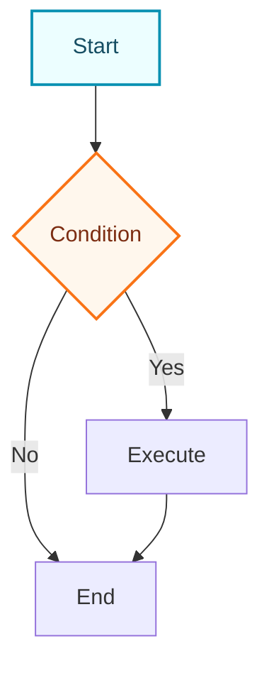

# Mermaid Diagram Generator

Generate high-quality Mermaid diagrams and render them as polished PNG files with Mermaid CLI.

## Workflow

1. **Understand requirements**: Identify the audience, diagram purpose, destination path, and most suitable diagram type.
2. **Read documentation**: Read the corresponding syntax reference for the diagram type before writing Mermaid syntax.
3. **Write source**: Create a `.mmd` file with clean Mermaid syntax and diagram-level styling when useful.
4. **Render PNG**: Use Mermaid CLI (`mmdc`) to render a PNG unless the user explicitly asks for Mermaid code only.
5. **Verify output**: Confirm the PNG exists and re-run after fixing syntax, layout, or rendering issues.

## Mermaid CLI Rendering

Use `mmdc` when available. If it is not installed, use `npx -y @mermaid-js/mermaid-cli` without asking unless the environment blocks package downloads.

Preferred command:

```bash
npx -y @mermaid-js/mermaid-cli \
  -i diagram.mmd \
  -o diagram.png \
  -c /home/razuer/.config/opencode/skills/mermaid/assets/mermaid-cli-config.json \
  -p /home/razuer/.config/opencode/skills/mermaid/assets/puppeteer-config.json \
  -b white \
  -w 2400 \
  -H 1600 \
  -s 2
```

Rendering rules:

1. Save both the source `.mmd` and rendered `.png` unless the user requests only one file.
2. Use a clear filename based on the diagram topic, for example `checkout-flow.mmd` and `checkout-flow.png`.
3. Keep output in the requested directory. If no directory is requested, use the current workspace directory.
4. Use the bundled config files by absolute path when running from outside this skill directory.
5. Prefer `-b white` for documents and transparent backgrounds only when the user requests overlay-ready assets.
6. Increase `-w`, `-H`, or `-s` for dense diagrams. Do not shrink text below readability to force a large graph into one image.
7. If Chromium sandbox errors occur, keep using the bundled `puppeteer-config.json`; it already includes the no-sandbox flags Mermaid CLI commonly needs in constrained Linux environments.

## Visual Quality Standards

Design for readability first:

1. Choose the simplest diagram type that communicates the idea.
2. Use short labels, consistent casing, and meaningful node IDs.
3. Limit a single PNG to roughly 7-9 major visual groups. Split larger systems into multiple diagrams.
4. Prefer left-to-right flowcharts for user journeys and top-to-bottom flowcharts for pipelines or lifecycles.
5. Use subgraphs to group domains, services, phases, or ownership boundaries.
6. Add Mermaid `classDef` styles for emphasis only when they clarify meaning.
7. Avoid decorative color overload; reserve accent colors for critical paths, external dependencies, errors, or decisions.
8. Re-render after layout changes and inspect CLI errors rather than guessing.

## Diagram Type Reference

Select the appropriate diagram type and read the corresponding documentation:

| Type | Documentation | Use Cases |
| ---- | ------------- | --------- |
| Flowchart | [flowchart.md](references/flowchart.md) | Processes, decisions, steps |
| Sequence Diagram | [sequenceDiagram.md](references/sequenceDiagram.md) | Interactions, messaging, API calls |
| Class Diagram | [classDiagram.md](references/classDiagram.md) | Class structure, inheritance, associations |
| State Diagram | [stateDiagram.md](references/stateDiagram.md) | State machines, state transitions |
| ER Diagram | [entityRelationshipDiagram.md](references/entityRelationshipDiagram.md) | Database design, entity relationships |
| Gantt Chart | [gantt.md](references/gantt.md) | Project planning, timelines |
| Pie Chart | [pie.md](references/pie.md) | Proportions, distributions |
| Mindmap | [mindmap.md](references/mindmap.md) | Hierarchical structures, knowledge graphs |
| Timeline | [timeline.md](references/timeline.md) | Historical events, milestones |
| Git Graph | [gitgraph.md](references/gitgraph.md) | Branches, merges, versions |
| Quadrant Chart | [quadrantChart.md](references/quadrantChart.md) | Four-quadrant analysis |
| Requirement Diagram | [requirementDiagram.md](references/requirementDiagram.md) | Requirements traceability |
| C4 Diagram | [c4.md](references/c4.md) | System architecture (C4 model) |
| Sankey Diagram | [sankey.md](references/sankey.md) | Flow, conversions |
| XY Chart | [xyChart.md](references/xyChart.md) | Line charts, bar charts |
| Block Diagram | [block.md](references/block.md) | System components, modules |
| Packet Diagram | [packet.md](references/packet.md) | Network protocols, data structures |
| Kanban | [kanban.md](references/kanban.md) | Task management, workflows |
| Architecture Diagram | [architecture.md](references/architecture.md) | System architecture |
| Radar Chart | [radar.md](references/radar.md) | Multi-dimensional comparison |
| Treemap | [treemap.md](references/treemap.md) | Hierarchical data visualization |
| User Journey | [userJourney.md](references/userJourney.md) | User experience flows |
| ZenUML | [zenuml.md](references/zenuml.md) | Sequence diagrams (code style) |

## Configuration & Themes

- [Theming](references/config-theming.md) - Custom colors and styles
- [Directives](references/config-directives.md) - Diagram-level configuration
- [Layouts](references/config-layouts.md) - Layout direction and spacing
- [Configuration](references/config-configuration.md) - Global settings
- [Math](references/config-math.md) - LaTeX math support

## Output Specification

Deliverables should include:

1. A rendered PNG path.
2. The source `.mmd` path.
3. A short note if Mermaid CLI could not run, including the exact blocking error and the Mermaid source file that remains available.

Generated Mermaid source should:

1. Have correct syntax that renders directly through Mermaid CLI.
2. Have clear structure with proper line breaks and indentation.
3. Use semantic node naming.
4. Include styling when needed to improve visual appearance.
5. Avoid Markdown code fences inside `.mmd` files.

## Example Output

`checkout-flow.mmd`:



Render it with Mermaid CLI and return the generated `checkout-flow.png` path.

---

User requirements: $ARGUMENTS
